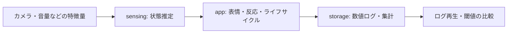

# 設計と検証の読みどころ

Androidのライフサイクル、センサーからの状態推定、長時間稼働の計測を中心にした開発例です。判定精度や連続稼働時間の実測値を、コードのテスト成功から推定していません。

## コードを読む順番

1. [PresenceStateMachine.kt](../sensing/src/main/java/com/taki/petrobot/sensing/PresenceStateMachine.kt): タイムスタンプ付き入力から在席状態へ遷移する処理。
2. [ThermalLoadController.kt](../sensing/src/main/java/com/taki/petrobot/sensing/ThermalLoadController.kt): 熱状態に応じた負荷制御。
3. [LogReplayEngine.kt](../sensing/src/main/java/com/taki/petrobot/sensing/LogReplayEngine.kt): 保存済みの数値ログから判定を再確認する処理。
4. [StructuredLogStore.kt](../storage/src/main/java/com/taki/petrobot/storage/StructuredLogStore.kt): 構造化ログの保存境界。
5. [sensingのJVMテスト](../sensing/src/test) / [Android CI](../.github/workflows/android-ci.yml): ロジックとAPKの確認。

生の画像・音声を残すと後から再解析できる反面、保存・管理する情報が増えます。本実装は特徴量と状態の記録を選び、個人識別や生メディア保存を行わない境界を、モジュール分割とガードレール検査で確認します。

## 確認結果

公開版のCIでは、テスト、Lint、Debug APKの組み立て、v0ガードレール検査を実行します。[実行履歴](https://github.com/taki-codes/pet-robot-portfolio/actions)から各ステップの結果を確認できます。

公開用ソースでは2つの音源を再配布可能な同梱CC0音源へ差し替えています。この版のTest / Lint / APK / guardrailsは [公開版のAndroid CI](https://github.com/taki-codes/pet-robot-portfolio/actions/workflows/android-ci.yml) で検証します。

実機は今回接続されていません。権限拒否、カメラ・マイクの実挙動、復帰、発熱、24時間稼働は [テスト計画](test-plan.md) と [24時間試験](24-hour-sensing-test.md) に沿う別の確認が必要です。センサー精度や省電力効果の数値は未提示です。
